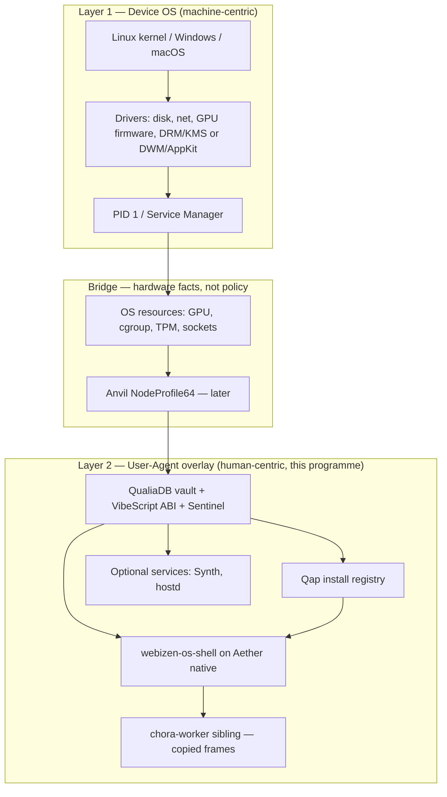
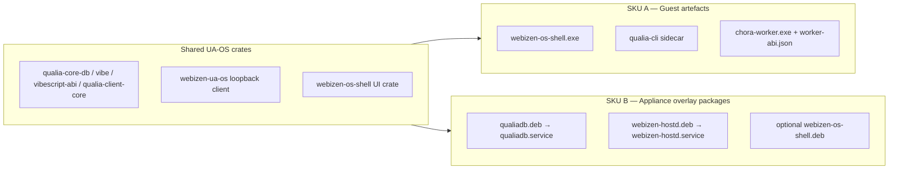
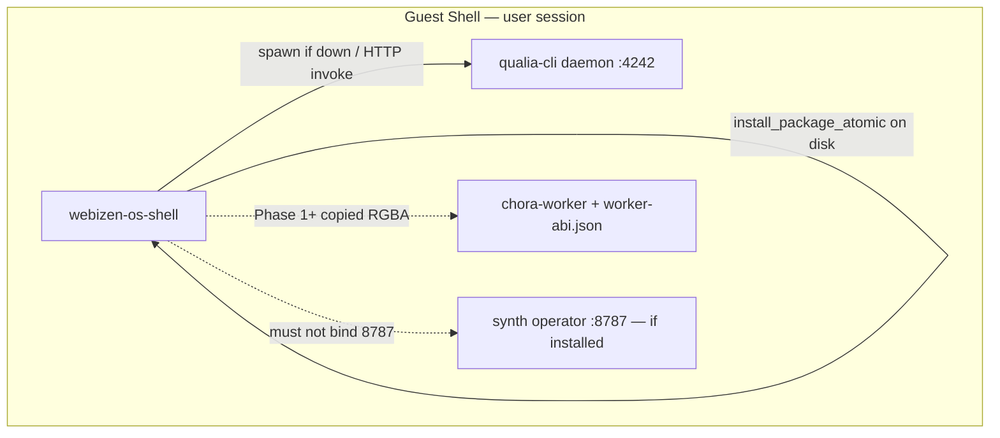
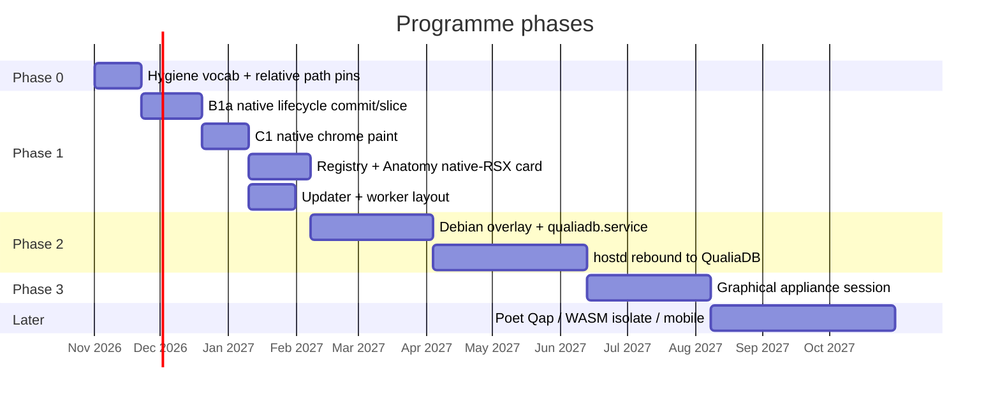

# Webizen OS-Shell, Dual-Environment Runtime, and Installable Applications

Canonical copies: `C:\github\webizenai\docs\planning\` (this file) and `webizen-os-shell/docs/planning\`. Index: [README.md](README.md). Do-first sequence: [01-do-first-blockers.md](01-do-first-blockers.md).

| Field | Value |
|---|---|
| **Document** | Webizen OS-Shell dual-SKU architecture |
| **Author** | Design draft for Timothy Charles Holborn |
| **Date** | 2026-11-20 |
| **Status** | Draft (revision 3g) |
| **Audience** | Senior engineers working in QualiaDB, Aether, Webizen, Chora, Synth, and webizen-host |
| **Language** | Australian English |
| **Scope** | Planning only — no product source is modified by this document |

Vocabulary: this programme uses **human-rights, fiduciary, guardianship, and human-agency** language. The terms “sovereign” and “self-sovereign” are prohibited in new work. They appear below only as **cited defects** in existing trees.

Licence ring-fence (already decided) — **three rings**, neither absorbing another:

| Ring | What | Licence |
|---|---|---|
| **A — Device OS** | Debian Trixie (Appliance); Windows / Linux / macOS (Guest) | Unmodified **upstream** licences |
| **B — User-Agent overlay** | QualiaDB, Webizen shell, Aether, Synth, Poet, Anvil, Etalon, webizen-host | Temporary **CC BY-NC-ND 4.0** |
| **C — webizen-WWW-engine** | Independent MPL-2.0 Servo-derived old-web engine (GitHub still `WebCivics/chora` until renamed). QualiaDB **Chora** canvas is Ring B. Future anti-slavery licence is Ring B only. Sibling worker; never mix files. | **MPL-2.0** |

Engine hosts talk through generic traits and `ffi/capi`. User-visible installer notices and the Synth service-discovery `license` field are **CC BY-NC-ND 4.0**. A later swap to the **humanitarian equity / anti-slavery** fabric at `https://github.com/mediaprophet/license` is **out of scope** (not a Phase 1 PR) and applies to **Ring B only** — it does not relicense Debian or the MPL engine. Do not copy Servo Covered Software into Ring B. Do not add `qualia-*` / `webizen-*` dependencies inside the engine. Do not copy Debian (GPL/LGPL/etc.) sources into Ring B, or Ring B sources into Debian packages. Ring B crates must not path-depend on the `servo` crate. Synth crate files may still carry an erroneous bot Apache-2.0 stamp; G0 aligns them. Do not treat the trees as already matching. **Chora** (spatial commons / Qualia `chora/`) is Ring B. See [04-chora-name-and-servo-engine.md](04-chora-name-and-servo-engine.md) and [05-licence-ring-fence.md](05-licence-ring-fence.md).

---

## Overview

Webizen currently has two stale desktop shells and a separate VPS host tree. Neither desktop tree is the product we should ship. The successor is **one User-Agent OS core** — QualiaDB graph/state, VibeScript ABI, Qap install registry, Aether-native chrome — packaged as **two SKUs with two signed artefact families**, not one binary:

1. **Guest Shell** — `webizen-os-shell` as an application on Windows, macOS, and Linux. The host Device OS is left intact. Qualia runs as `qualia-cli daemon` on loopback `:4242`.
2. **Appliance / User-Agent overlay** — overlay packages (`qualiadb`, `webizen-hostd`, optional `webizen-os-shell`) as the user-space personality on an **unmodified Debian Trixie Device OS** (VPS first, later a graphical appliance, later mobile). This is a **piggyback overlay**, not a Debian fork and not a “Webizen distro”. This programme does **not** start a custom kernel, LFS, or Yocto distribution.

Phase 1 Guest chrome is **Aether native** (local path pin of the dirty native tree, not GitHub `d5ccce3`). Committed Aether-desktop/Wry is a **time-boxed off-ramp only** if native window paint fails the C1 acceptance test. Applications such as **Poet**, services such as **Synth**, and the **old-web engine** worker are **installed or sibling artefacts**. They are not compiled into the shell. `.qpkg` is a **zip** distribution envelope; **installation** means `install_package_atomic` plus `registry.json`.

Aether is a GUI toolkit (Dioxus fork), not the OS and not the shipped app. The old-web engine is an independent MPL-2.0 Servo-derived tree; composition is a **copied-frame worker sibling binary**. **Chora** is Qualia’s spatial commons canvas (Ring B). QualiaDB is the required application foundation. There is **no wasmtime** in Qualia today; Phase 1 does not invent one.

---

## Background & Motivation

### Why this change is needed

The desktop product has forked into two old trees under `C:\github\webizenai\`, which is **not itself a git repository**. Each child is an independent clone:

| Tree | Origin | HEAD (inspected 2026-11-20) | Age vs siblings | Dirty? |
|---|---|---|---|---|
| `C:\github\webizenai\webizen-desktop` | `https://github.com/WebizenAI/webizen-desktop.git` | `a323181` 2026-10-04 *Initial standalone Webizen Desktop shell repository* | ~7 weeks behind QualiaDB `0.0.41.3` | Clean tracked tree |
| `C:\github\webizenai\webizen-os-shell` | `https://github.com/WebizenAI/webizen-os-shell.git` | `75328cb` 2026-10-04 *fix(shell): resolve RSX signal bindings…* | Same | Clean tracked tree |

No second clone exists at `C:\github\webizen-desktop`. The GitHub Desktop clone **is** `C:\github\webizenai\webizen-desktop`. There is no `C:\github\webizen-navigator`. `C:\github\poet` **does** exist (Canvas_Workbench JS, `qualia-ui` Dioxus/Aether, specs) — it is one of several Poet trees (KD-9), not a Phase 1 seed. The OS-shell remote is already `webizenai` (`https://github.com/WebizenAI/webizen-os-shell.git`); C1 is the Aether port of that repo, not a gate on moving it.

Both desktop trees still declare QualiaDB as `path = "../qualiaDB/crates/…"`. From `webizenai/` that path does **not** exist; the live engine checkout is a **sibling of `webizenai`**, not a child. Those manifests cannot resolve their declared engine without a **relative** remap (`../../qualiaDB/...` from `webizenai/webizen-os-shell`). Do **not** commit absolute `C:\github\qualiaDB` paths. Do **not** pretend Cargo interpolates `WEBIZEN_QUALIA_ROOT` in `path =`. Optional local override is `.cargo/config.toml` `[patch]`, documented in the A5 pin file. `webizen-host` *does* resolve `../qualiaDB/crates/vibe` correctly from its repo root. OS-shell currently path-depends `qualia-core-db` and `qualia-cooperative-core` **without using them in any `.rs` file**.

Meanwhile Aether, QualiaDB, Chora, and Synth have moved:

| Tree | HEAD | Dirty tracked files | Notes |
|---|---|---|---|
| `C:\github\Aether` | `d5ccce3` 2026-11-06 *feat(aether): complete … dioxus -> aether rename* | **Yes (40 tracked)** | Native production is largely **uncommitted**. `packages/native/src/chora_frame.rs` is **untracked** (`??`), not in the 40. |
| `C:\github\qualiaDB` | `972df30ad` 2026-11-19 on `0.0.41.3` | **Yes (29)** | Branch is **behind origin by 2** |
| `C:\github\chora` | `eb08f915733` 2026-11-20 *docs: point independent Chora repository at WebCivics/chora* | **Yes (77)** | Origin `https://github.com/WebCivics/chora.git` |
| `C:\github\synth` | `901886c9` 2026-11-18 on `0.0.41.3` | **Yes (4)** | Already ships signed installers |
| `C:\github\webizen-host` | `436cd68` 2026-11-03 | **Yes (5, docs)** | VPS product is specified; implementation is not production-qualified |

### Current state of the two desktop builds

**Tauri harness (`webizen-desktop`).** `Cargo.toml` pins `tauri = "=2.11.5"` with `tauri-plugin-updater`, notifications, and dialogs. `tauri.conf.json` names the product `Webizen`, identifier `org.webizen.browser`, and still expects `frontendDist: "../webizen-studio/dist"` plus bundled `static/portal`. Empty feature `servo = []`. The default launch path is the HTML OS-shell (`src/shell/os_shell.rs` embeds `static/os-shell/{index.html,shell.css,volumes/*}` via `include_str!`). Volumes are **dedicated HTML**, not Studio SPA iframes. Legacy Studio remains behind `WEBIZEN_LEGACY_SHELL` / `--legacy-shell`.

Prohibited vocabulary (exact): README starts “Sovereign desktop harness…”; `qapp.json` `"description": "Sovereign desktop window manager, app launcher, and host environment for Qualia QApps."`; `Cargo.toml` description “Sovereign Desktop Shell…”. The README claims a `.qpkg` runtime for `poet`, `webizen-wallet`, `webizen-comms`, `webizen-health`. **No `.qpkg` reader exists in this tree** — the only `.qpkg` hit is that README sentence.

Real install lives in QualiaDB `crates/qualia-client-core/src/qapp_install.rs` (`install_package_atomic`). Tauri commands `list_installed_qapps`, `verify_and_install_qapp`, `launch_installed_qapp` in `src/commands/mod.rs` wrap `qualia_client_core::api::{qapp_vault,qapp_launcher}` helpers that require `APP_STATE` and return a `file://` or `http://localhost:{dev_port}` URL. `verify_and_install_qapp` always uses `InstallPolicy::Development` and `trust_pubkey: None`.

**Dioxus-native prototype (`webizen-os-shell`).** Six Rust sources plus CSS. Edition 2021. `Cargo.toml` depends on **Dioxus 0.8.0-alpha.1**, patched to `DioxusLabs/dioxus` rev `0dbfab5274`, **not Aether**. `Dioxus.toml` `default_platform = "desktop"`. README names Dioxus, not Aether, and does **not** contain the word “Sovereign”. Prohibited vocabulary (exact): `Cargo.toml` `description = "Sovereign Webizen OS-Shell desktop & web portal built in pure Dioxus"`; `src/state/shell_state.rs` `did:q42:webizen:human-sovereign-01`; `orbit_wheel.rs` “Multi-Rail Sovereign Vault” / “Sovereign Hypermedia Vault”; `stage_host.rs` “Webizen Directory · Sovereign Graph”. `StageHost` is a **placeholder modal** with no launcher. Halo / orbit chrome is the intended spatial UX.

**Pain points**

- Two shells, one UX intent, neither on current Aether native.
- Apps are either HTML volumes compiled into the Tauri binary or a prototype that cannot launch anything.
- QualiaDB already has an install registry the shells barely use; the *library* surface is `install_package_atomic`, not the `APP_STATE` API helpers.
- webizen-host reimplements Qualia types instead of linking `qualia-core-db` (same **256-byte** header size, different magic/layout).
- Neither desktop tree embeds Chora correctly.
- Synth already installs as its own product and must not be swallowed by a fat shell.

### Packaging-brief intent (not engineering truth)

`C:\github\webizenai\Packaging WebizenOS Tri-Target Linux Distribution.md` is a Gemini conversation. Token-budget tables are **prior conversation estimates**, not estimates this programme adopts. Where that file says “WebizenOS distribution”, this programme qualifies it as a **User-Agent overlay on Debian Trixie**, not a forked OS and not Webizen IP in the kernel/init. Adopted from the later clarification:

- Device OS is **not** the User-Agent overlay.
- Piggyback on Debian for drivers; overlay user-space personality under `/opt/webizen`.
- VPS first, then graphical appliance, then mobile.
- Local-first / personal-cloud routing.
- Do not start with LFS, Yocto, or a custom kernel. Debian stays unmodified upstream.

---

## Goals & Non-Goals

### Goals

1. Advance **webizen-os-shell on Aether native** (local path pin) as the successor chrome. Retire Tauri as the long-term shell.
2. Define an **install model** that works on both SKUs. The shell does not ship every app.
3. Specify **two SKUs** with a shared crate family and **two artefact families**.
4. Place **webizen-host** as the VPS personality of the same User-Agent OS.
5. Define how **Synth**, **Poet**, and **Chora** run on each SKU.
6. A **phased roadmap**: Guest Shell first, then VPS user-space, then graphical appliance. Mobile later.
7. Honour the **three-ring** licence fence (Device OS / User-Agent overlay / Chora) and QualiaDB-as-foundation.

### Non-Goals (this programme / this phase)

- A custom Linux distribution, Debian fork, LFS, Yocto, NixOS-from-scratch, or bootc **as the Device OS**. (`debootstrap` / `mmdebstrap` / `bootc` may be used as **tools** to materialise unmodified Trixie — KD-19.)
- Replacing the Linux kernel, systemd-as-PID-1, Mesa, libc, or vendor GPU drivers; vendoring those sources into Qualia/Webizen trees.
- Copying Debian (GPL/LGPL/etc.) sources into Ring B, or Ring B sources into Debian packages / a DFSG derivative.
- In-process linking of Chora into Aether native or QualiaDB.
- Copying Chora Covered Software into CC BY-NC-ND trees, or adding `qualia-*` / `webizen-*` crates inside Chora.
- Using “WebizenOS” to imply the kernel or init is Webizen IP.
- Treating Aether as the OS or the shipped product.
- Unifying Poet into a newly invented single repository in this pass, or picking a winner among Poet trees on the C1 path (Group H is later).
- Absorbing Talk / Mail / Wellfair / Poet / Anatomy 3D into the QualiaDB workspace as crates. First-party apps are independently updatable packages.
- Migrating existing `did:qualia:qapp:` tags, putting package IDs on the who plane, or renaming on-disk `{storage}/Qapps` / `qapp.json` in C0/C2/D1/D4 (product language is **Qap / Qaps**; a later hygiene PR may add a `Qaps` directory alias).
- Advertising hardware-attested vaults without `anvil-scraper` NodeProfile64 on that box.
- Making WSL the first public artefact.
- Shipping `servo_*` in `worker-abi.json` or treating README aliases as the C ABI rename.
- Moving `webizen-os-shell` to WebCivics in this programme.
- Mobile (Android AVF / iOS) as a near-term SKU.
- Claiming production completeness for Aether native, webizen-host, or Chora embedding.
- Rewriting QualiaDB’s Q42 format, VibeScript ABI, or Sentinel in the shell.
- Inventing a native **wasmtime/WASI** Qap isolate (it does not exist in QualiaDB).
- Phase 1 tray, Phase 1 Poet launch, Phase 1 WASM Qaps, Phase 1 Chora-as-Qap.
- Loading `bundled/qapps/Anatomy/index.html` (Babylon.js SPA) as an HtmlStage. Inventing a Phase 1 script-refuse HTML gate. Using `C:\github\anatomy\web\index.html` as the seed.
- Designing the future `mediaprophet/license` anti-slavery / humanitarian-equity instruments, relicensing the Servo-derived engine away from MPL-2.0, or applying that future swap to Debian / Device OS.

---

## Key Decisions

### KD-1 — Successor chrome is webizen-os-shell on Aether native; Tauri is retired as the long-term shell

**Decision.** Port `webizen-os-shell` to `aether` / `aether-native` via a **recorded local path pin** of the Aether working tree (KD-12). Not `dioxus` 0.8-alpha, not Tauri, not GitHub `d5ccce3` as a native-ready pin. Preserve halo bar, orbit volumes, and stage host as native RSX. Tauri `webizen-desktop` remains a **read-only behaviour reference**. The git remote stays **`webizenai`** (`C:\github\webizenai\webizen-os-shell`). Do not wait for the Aether port to “land” before owning that remote — **C1 is the Aether port** and is scheduled work. No move to `WebCivics/webizen-os-shell` in this programme unless Timothy later says so.

**Rationale.** The OS-shell tree already expresses the intended spatial UX without WebView IPC. Aether’s native renderer is the toolkit the ecosystem is overhauling toward. Synth’s `d5ccce3` pin is **desktop/Wry** (`aether` features include `desktop`); `packages/aether/src/launch.rs` prefers native when both `native` and `desktop` are on, but that does not make `d5ccce3` native-qualified.

**Consequence.** No new Tauri commands, no new `include_str!` HTML volumes, no Tauri capability JSON as the capability model. Aether-desktop/Wry is **not** the primary path; see KD-18.

### KD-2 — Dual SKU, shared crate family, two artefact families

**Decision.** Shared libraries (`qualia-client-core` install, `webizen-ua-os` host client, OS-shell UI crate). **Two signed artefact families**, not one binary:

| SKU | Artefacts | Session owner | QualiaDB |
|---|---|---|---|
| **Guest Shell** | `webizen-os-shell` (+ `qualia-cli` sidecar, optional `chora-worker`) | Host window manager | User-scoped `qualia-cli daemon` on `127.0.0.1:4242` |
| **Appliance / UA OS** | Debian overlay packages: `qualiadb.deb`, `webizen-hostd.deb`, optional `webizen-os-shell.deb` | `webizen-session.service` later; VPS is headless | `qualiadb.service` ExecStart of the same `qualia-cli` binary |

Cargo features that bake systemd unit templates, `/var/lib/qualiadb`, or hostd **must not** land in the Windows Guest exe. Overlay prefix is **`/opt/webizen`** (FHS `/usr/lib/webizen` is not used in this programme unless Timothy overrides).

**Rationale.** Shared core is right; “same binary, appliance feature profile” is not packaging.

### KD-3 — Debian as Device OS substrate; User-Agent overlay is piggyback, not a distro

**Decision.** Appliance images and VPS bootstrap start from **unmodified Debian 13 Trixie minimal** (amd64, later arm64). Overlay: systemd units, `/opt/webizen` binary closure, encrypted `/var/lib/qualiadb` vault, `webizen.target`. Overlay debs **Depend** on Debian packages; they do not vendor kernel, libc, systemd, or Mesa. No Nix, LFS, or Yocto as the Device OS. `debootstrap` / `mmdebstrap` / `bootc` are allowed only as **tools** to materialise Trixie (KD-19).

### KD-4 — Installable Qaps; `.qpkg` is a zip envelope around the Qualia directory installer

**Decision.** Product language is **Qap** (singular) / **Qaps** (plural) — Qualia App. “QApp” / “QApps” are legacy spellings in code and docs. Canonical **on-disk** unit (Phase 1 compatibility; keep these paths in C0/C2/D1/D4):

- Manifest: `qapp.json` (`QAPP_PACKAGE_MANIFEST`). Install key remains `qapp.json` `name` (`package_id_from_manifest`).
- **`storage`** is Qualia’s vault parent (`LoopbackHost.storage`). Guest: platform user-data dir. Appliance: `/var/lib/qualiadb`.
- Store: `{storage}/Qapps/{package_id}/`. Registry: `{storage}/Qapps/registry.json`. Qualia `qapps_dir(storage)` joins `"Qapps"` onto that argument — **never** pass `{storage}/Qapps` into `install_package_atomic`.
- Library installer: **`install_package_atomic(&self.storage, …)` + `QappInstallRegistry` only**. Do not call `verify_and_install_qapp` / `launch_installed_qapp*` from the shell (those live under `crates/qualia-client-core/src/api/qapp_vault.rs` and `src/api/qapp_launcher.rs`, require `APP_STATE`, and return Tauri URLs). Crate names (`qapp_install`, `bundled_qapps`, `QappInstallRegistry`) stay until a dedicated rename PR; new types in this programme may use `Qap*` (`QapPackageSpec` in `crates/qualia-app-contract/src/qap_package.rs` already does).
- Launch: a new `LaunchPlan` (package dir, entrypoint path, kind) with **no** `APP_STATE`. URL launch remains a Tauri compatibility helper.

**`.qpkg`:** ZIP only for the magic/extension. File association on Windows/macOS opens a zip. `tar.gz` is an **optional Appliance unpacker** of the same inner directory; it is not `.qpkg`. One directory installer after unpack.

**yaml-ld-q42:** installer **always writes a synthetic `qapp.json`** so registry identity is uniform. Independent of `.qpkg` unpack.

Phase 1 seed: **Settings as built-in chrome** + **Anatomy** as the seed **Qap**, **installed** from the tracked `qualiaDB/bundled/qapps/Anatomy/` tree into `{storage}/Qapps`. Opening it is a **native-RSX card** (“installed; 3D view later”). Not Poet. Not WASM. Not HtmlStage. Not `index.html`. Other orbit slots are **platform entry placeholders**, not Qualia crates (KD-21). An optional later hygiene PR may add a `Qaps` directory alias or migrate `{storage}/Qapps`; that is not Phase 1. Identifier-fabric package coordinates: KD-20. ADR 0012 (“QApp is not a runtime type”) is composition **inside** a Qap (Anatomy → manifold `anatomy`); it leaves this install model in place.

### KD-5 — webizen-host is the VPS personality of the User-Agent OS

**Decision.** `webizen-hostd` is the network-facing supervisor on Appliance VPS — the same User-Agent overlay on a **stock distro**, same three-ring fence (KD-19). Guest Shell usually **pairs remotely** (Mode B, later). The Poet admin workbench is the **host control plane**, not the spatial OS-shell. Host facsimile volumes (`Q42\x04` magic, different layout) are **never** mounted as Qualia vaults.

### KD-6 — Old-web engine is always a separate process; Phase 1 ships a Ring C sibling worker, not a Qap

**Decision.** Native paints **copied frames**. The worker binary is **Ring C (MPL-2.0)**, built from `C:\github\chora` (product **webizen-WWW-engine**). Isolation is the **process**, not Servo's `multiprocess` feature (that feature is **off** in `embedded_library`). Ring B (Aether, Qualia, shell) talks over IPC / C ABI only. Ring B crates must not `path` or `git` depend on the `servo` crate.

MPL §1.7 / §3.3 first sentence would allow a Larger Work that links `embedded_library` if no Covered Software is copied into Ring B files. **This programme does not take that path.** Static linking of the engine into a Ring B crate is forbidden. If the future anti-slavery licence cannot sit beside an MPL sibling program, **drop this engine**.

**Known leak:** `Aether/packages/chora-worker` declares CC BY-NC-ND and path-depends on `../../../chora/components/servo`. **E0 closes it** by shipping `{install}/www-engine-worker` (today's path `{install}/chora-worker`) from the engine tree. `aether-chora-client` and `aether-chora-bridge-protocol` stay Ring B: they speak the wire protocol; they do not link Covered Software.

**Phase 1 packaging:** `{install}/chora-worker` (`.exe` on Windows) until renamed `{install}/www-engine-worker` + `{install}/worker-abi.json` (engine rev, protocol version, pixel format RGBA). **Not** a Qap. `ports/servoshell` as an installed Qap is **out of Phase 1**. **E0 ships `chora_*` only** until E5 (`www_*`). No `servo_*` in `worker-abi.json`. README aliases are not a substitute.

`packages/native/src/chora_frame.rs` is **untracked** today. Copied-frame UI (E3) waits on B1b. See [05-licence-ring-fence.md](05-licence-ring-fence.md).

### KD-7 — QualiaDB is the application foundation; Aether is the toolkit; Etalon is not shared with Chora

**Decision.** Graph, VibeScript, Sentinel, vault from QualiaDB. Aether supplies RSX/native window. Two Etalon devices (shell vs worker). Anvil is not Phase 1. **Do not advertise hardware-attested vaults** until `anvil-scraper` NodeProfile64 exists on that box. VPS overlay (F4) can ship without Anvil; attestation claims are Anvil-gated. Native `Document::eval` is still `NoOpDocument` — Qaps must not depend on in-window JS or Vibe eval in Phase 1.

### KD-8 — Synth is an installed service/tool, not a bundled stage; licence is CC BY-NC-ND 4.0

**Decision.** Synth remains its own signed artefact. Guest discovers it on `127.0.0.1:8787+` if installed. Guest Shell **must not bind 8787**. The shell does not vendor Synth.

**Licence.** User-visible installer notices and the service-discovery `license` field are **CC BY-NC-ND 4.0**, matching Qualia / Aether / Webizen. On-disk Apache-2.0 on Synth `LICENSE` / `Cargo.toml` was an **erroneous bot decision**; G0 aligns those files. G1 includes `license: "CC BY-NC-ND 4.0"` and depends on C3 only. A later swap to `https://github.com/mediaprophet/license` is out of scope and **Ring B only**. **webizen-WWW-engine stays MPL-2.0.** **Chora** (spatial commons) is Ring B.

### KD-9 — Poet is a separate programme after Guest can install/load apps; Phase 1 does not launch it

**Decision.** **Phase 1 does not launch Poet.** Poet is a **separate workstream** after Guest Shell can install/load apps. History: Codex/OpenAI redesigned Poet as an interface for itself; hypermedia-production / Synth grew from that. Extant trees include at least:

- `C:\github\poet` (Canvas_Workbench JS, `qualia-ui` Dioxus/Aether, specs)
- webizen-desktop Poet harness / volumes / `commands::poet*`
- website WASM Poet
- QualiaDB `poet_host`
- Synth as the production tool that absorbed some of that work

The first Guest increment **must not pick a winner** among those trees. Group **H** (after C3, not on the C1 critical path) catalogues the splits and chooses a loadable Qap/host.

### KD-10 — Guest Shell first, then VPS user-space, then graphical appliance, then mobile; WSL is developer capacity first

**Decision.** Do not block Guest Shell on systemd, Wayland cage, cloud-init, or AVF.

**WSL.** Sequence: (1) **developer** WSL Trixie overlay so Appliance packaging can be built/tested on a Windows machine; (2) **public SKUs** = native Guest on Windows/Linux/macOS and Appliance on real Debian Trixie (and later a supported WSL Appliance SKU if that overlay is real). WSL is not skipped; it is not the first public artefact. C6 stays Windows native Guest. **F4-wsl** comes after F4, not on C1.

### KD-11 — Capability model is Qualia Sentinel + Qap leases, not Tauri ACL JSON; no wasmtime fiction

**Decision.** Production policy is Sentinel / `vibescript-abi` plus `install_qapp_capabilities`. Host `Tier2QAppIsolate` is a path-prefix struct with **no wasmtime and no wasmer** in QualiaDB (`vibe-wasm` is `wasm-bindgen` for the browser). **Phase 1 forbids WASM Qaps.** Phase 1 launch kinds: `NativeRsxCard` (Anatomy seed) / yaml-ld / native-process. **HtmlStage with JS is deferred until Chora/eval** — not used for Anatomy, and Phase 1 does not invent a script-refuse HTML gate. A wasmtime isolate would be a **new Qualia work item**, not reuse.

Lease sheet (Production fail-closed if empty):

```json
{
  "package_id": "Anatomy",
  "version": "…",
  "who_plane_subject": null,
  "guardian_install": false,
  "default": "deny",
  "families": [
    { "id": "graph.query", "grant": false }
  ]
}
```

`package_id` is the install key from `qapp.json` `name` (`package_id_from_manifest` → `"Anatomy"`), **not** a person and **not** `did:q42:`. `who_plane_subject` is a later identity-plane field; Phase 1 Anatomy card does **not** require a living-who DID. Do not put `did:q42:` or `did:qualia:qapp:` on the who plane. Guardian installs cannot widen the dependent’s families.

### KD-12 — Aether pin, honesty, and CI graph

**Decision.**

- Phase 1 **consumes a recorded local Aether path pin** (`aether = { path = "../../Aether/packages/aether" }` from `webizen-os-shell`). Record HEAD `d5ccce3` **plus dirty hashes** (A5). **Do not claim GitHub `d5ccce3` is native-ready.** Optional checkout override is `.cargo/config.toml` `[patch]` in the A5 pin file, not a Cargo env var.
- Substantial local work exists and is not committed; several Windows probes pass; production, pixels, containment, installed artefacts, and VibeScript eval do not.
- Phase 1 CI = **live-sources with those recorded dirty hashes**. Frozen-v4 is Appliance/release only **after** WDAC/getrandom receipts. Do not mix profiles in one Guest artefact.

### KD-13 — Guest Qualia session is a loopback client to `qualia-cli daemon :4242`

**Decision.** Guest Shell **always** discovers `127.0.0.1:4242`. If down, spawn the **`qualia-cli` sidecar** with `daemon start --dev`. `UaOsHost` is an **HTTP/loopback client** to that daemon (install/launch still use local `install_package_atomic` on disk; graph/Sentinel/`/invoke` go to the daemon). **Do not** initialise `qualia_client_core::state::APP_STATE` in the shell.

**Storage convention (Qualia-native; one meaning of `storage`).** `LoopbackHost.storage` **is** Qualia `storage_path` — the vault parent, **not** the `Qapps` directory (legacy on-disk name; product language is Qaps).

| Path | Value |
|---|---|
| `LoopbackHost.storage` | Guest: platform user-data dir. Appliance: `/var/lib/qualiadb` |
| Qaps (on-disk dir `Qapps`) | `{storage}/Qapps/{package_id}/` |
| Registry | `{storage}/Qapps/registry.json` |
| `QUALIA_STORAGE_PATH` | `storage` (**not** `storage.parent()`) |
| `QUALIA_DATA_DIR` | `storage` |
| PID | `{storage}/run/daemon-service.json` |
| `install_root` | Guest artefact dir; sidecar `{install_root}/qualia-cli` (`.exe` on Windows) |

`install` calls `install_package_atomic(&self.storage, …)`. `qapps_dir(storage)` joins `"Qapps"` (`crates/qualia-client-core/src/qapp_paths.rs`). Passing `{storage}/Qapps` would land Anatomy at `Qapps/Qapps`.

**Runbook (`LoopbackHost::ensure_daemon`, PR C0).** Guest **always** exports both env vars to `storage` so the graph vault and the Qap registry cannot diverge, and so `runtime_dir()` never falls through to cwd:

| Env | Value | Tree use |
|---|---|---|
| `QUALIA_STORAGE_PATH` | `storage` | HTTP daemon vault (`crates/qualia-core-db/src/services/daemon.rs`); `runtime_dir()` fallback |
| `QUALIA_DATA_DIR` | `storage` | KeyVault + `runtime_dir()` first choice (`crates/qualia-cli/src/daemon.rs` `state_dir()`) |

`runtime_dir()` = `state_dir().join("run")` with `state_dir()` = `QUALIA_DATA_DIR` else `QUALIA_STORAGE_PATH` else **`cwd/.qualia`**. Guest always sets the two env vars, so the cwd fallback is unused. PID file: `{storage}/run/daemon-service.json` (`PID_FILE_NAME = "daemon-service.json"`). Bind `127.0.0.1:4242` (`DEFAULT_DAEMON_PORT`).

**Sidecar binary.** `{install}/qualia-cli` (`.exe` on Windows), then `PATH`. `daemon start` re-execs `std::env::current_exe()` (`spawn_detached_service_windows` / `_portable`). The shell must exec the **qualia-cli sidecar**, never itself.

**Probe.** Same helper as `ping_daemon` / Tauri `probe_daemon_port`: GET `http://127.0.0.1:4242/health` (engine JSON). Graph work is POST `/invoke`.

**Appliance.** `qualiadb.service` ExecStarts that **same `qualia-cli` binary** with the same two env vars pointing at `/var/lib/qualiadb`, **without** `--dev`.

Crash/restart: if the daemon dies, the shell respawns it once per session and surfaces a stage error on the second failure.

### KD-14 — Phase 1 seed is Settings chrome + Anatomy **installed**, opened as a native-RSX card

**Decision.** First visible product: HaloBar + OrbitWheel paint; Settings as built-in chrome; Anatomy **installed** from the **tracked** tree `qualiaDB/bundled/qapps/Anatomy/` into `{storage}/Qapps` via `install_package_atomic` (D4). Opening Anatomy in Phase 1 is a **native-RSX card**: “installed; 3D view later”. The shell does **not** load `index.html`, `lib/babylon.js`, `lib/babylonjs.loaders.min.js`, `qualia.js`, `daemon-client.js`, or any HtmlStage for Anatomy.

That bundled entry is a **Babylon.js SPA**, not a static pane: `qapp.json` has `preferred_launch_mode: "flutter-app-vault"`, `entrypoints.web = "index.html"`, `wasm.engine_package: "qualia-core-wasm"`. `bundled/qapps/Anatomy/index.html` loads `./lib/babylon.js` and `./lib/babylonjs.loaders.min.js` (and later `qualia.js`). Under native `NoOpDocument` that page is a dark full-viewport `#renderCanvas` that never hydrates.

The other tree `C:\github\anatomy\web\index.html` is script-free (links to `demo.html` / QualiaPortal). Phase 1 **does not** use it as the seed.

HtmlStage with JS is deferred until Chora/eval (later PR). Phase 1 does **not** invent a script-refuse HTML gate. `DEFAULT_BUNDLED_QAPPS` still lists eight names; several have stub `qapp.json` files. D4 installs **Anatomy only**.

### KD-15 — Qap Production trust root is a compiled first-party pubkey plus extra-keys file

**Decision.** `install_package_atomic(..., InstallPolicy::Production, Some(&FIRST_PARTY_PUBKEY))`. First-party Ed25519 pubkey is **compiled in** (Synth updater pattern: public key in binary, seed in CI). User-level extra-keys file `{storage}/qapp-trust-keys.json` (32-byte keys, steward-enrolment UI). Fail closed if Production and no key matches (`SignatureInvalid("no trust pubkey configured")` is the current library behaviour). Dev builds use `InstallPolicy::Development`. Do **not** reuse Tauri `tauri.conf.json` updater pubkey.

### KD-16 — Guest Shell updater is Synth-style Ed25519 over SHA-256

**Decision.** Public key compiled in. `webizen-os-shell update check|upgrade|verify|apply`. Never overwrite a locked running exe (copy to `.new`). Appliance uses Debian packages. This is locked for Phase 1; not left as an open question.

### KD-17 — Phase 1 Guest has no tray

**Decision.** Window lifecycle only (winit/Blitz). `aether-native` has no tray API; tray lives in `aether-desktop` (`packages/desktop/src/trayicon.rs`, Quit item, no-op handler; 460×460 fallback icon is already rejected on Windows). Do not promise Tauri tray parity. Tray is a later toolkit or desktop-backend increment, not C5.

### KD-18 — Aether-desktop Guest chrome is an off-ramp only if C1 native paint fails

**Decision.** **Primary path remains Aether native** (C1). **Rejected as the default Guest chrome.** Accepted only as a **time-boxed off-ramp**: if B1a does not yield a window that paints HaloBar/OrbitWheel under C1’s acceptance test, C1-desktop may port the same RSX to committed `aether`+`aether-desktop` at `d5ccce3` (Wry) for chrome-only iteration. That off-ramp does **not** change KD-1, does **not** reintroduce Tauri, and does **not** apply to Synth (G4: Synth may stay on desktop Aether because it already ships that pin as `native-ui`). Why the shell may not default to desktop while Synth may: the User-Agent overlay chrome is the Etalon/native product; Synth’s operator is a development tool already on Wry.

### KD-19 — Three licence rings: Device OS, User-Agent overlay, webizen-WWW-engine

**Decision.** The system OS stays independently licensed upstream software. Qualia / Webizen / related ecosystem code stays under the Ring B policy (temporary CC BY-NC-ND 4.0; later `mediaprophet/license` anti-slavery swap is out of scope and **Ring B only**). **webizen-WWW-engine** stays MPL-2.0. **Chora** (spatial commons) is Ring B. Neither side absorbs another.

1. **Debian is unmodified upstream.** Appliance is a **piggyback overlay**, not a Debian fork, not a relabelled Trixie “Webizen distro”, and not Yocto/LFS. Overlay prefix `/opt/webizen`. systemd units, apt metadata, and debs that Webizen ships **Depend** on Debian packages. They do not vendor kernel, libc, systemd, Mesa, or other Device-OS sources into Qualia/Webizen trees.
2. **No licence mixing of files.** Do not copy Debian (GPL/LGPL/etc.) sources into Qualia/Webizen/Aether/Synth repos under CC BY-NC-ND. Do not copy Qualia/Webizen sources into Debian source packages or into a Debian derivative that would put ecosystem code under DFSG/GPL expectations. Composition is a **Larger Work / overlay**: separate trees, separate licences, runtime co-installation.
3. **Guest SKU** never replaces the host OS. The shell is an app + sidecars (`qualia-cli`, later `chora-worker`, Synth). Host kernel, windowing, and package manager stay the user’s.
4. **Appliance SKU** installer may use debootstrap/bootc/mmdebstrap **as tools** to materialise a Trixie rootfs, then install the overlay. Generated rootfs artefacts are **build outputs**, not a relicensed OS. Packaging scripts that wrap those tools live in the Webizen packaging tree (CC BY-NC-ND) and **consume** Debian; they are not a Debian source package.
5. **webizen-host** is a VPS/personal-cloud personality of the same overlay on a stock distro, same ring-fence.
6. **Preferred vocabulary:** Guest vs Appliance; **User-Agent overlay / shell / runtime** vs **Device OS / host / base**. Do not use “WebizenOS” to imply the kernel or init is Webizen IP. Packaging-brief “WebizenOS distribution” means “User-Agent overlay on Debian Trixie”.
7. Future `mediaprophet/license` swap applies to **Ring B only**. It does not relicense Debian or the MPL engine. If that licence cannot sit beside an MPL sibling binary, drop the engine rather than mix files.

**Rationale.** Same policy family as the engine MPL fence and the CC BY-NC-ND 4.0 temporary licence: inspectable ecosystem work without claiming the host operating system, and without mixing GPL Device-OS sources or MPL Covered Software into Ring B trees.

**Consequence.** A7 lands the three-ring **notice matrix** (paths below). F4/D5 overlay units Depend on Debian; they do not vendor Device OS. D5 and C6 depend on A7 so the first overlay deb / Guest artefact cannot ship without the Ring B notice.

**Notice matrix (A7 implements; no source mixing):**

| Artefact | Ring A (Device OS) | Ring B (overlay CC BY-NC-ND 4.0) | Ring C (Servo-derived engine MPL-2.0) |
|---|---|---|---|
| **Source trees (git)** | **None.** No Debian sources, `debian/`, or `/usr/share/doc` copyright trees in Ring B repos. | Overlay packaging `LICENSE` / `LICENSE-BOUNDARY.md`. | Stays in the engine repo (`C:\github\chora`); copy beside `{install}/www-engine-worker` via E0. |
| **Overlay debs (D5/F4)** | Debian’s own copyright stays in Device OS files the deb **does not ship**. Deb `Depends:` those packages. | Deb `copyright` is Ring B. | Ring C `copyright` only on a worker package, if shipped. |
| **mmdebstrap/ISO (F4, optional SKU B delivery)** | Notices Debian already wrote into the Trixie rootfs, **left in place by the tool**, not vendored into Ring B git. Build output; **not committed**; not branded “WebizenOS”. | `/opt/webizen/LICENSE-BOUNDARY.md` | Worker notice only if the image includes `chora-worker`. |
| **Guest artefact (C6)** | The user’s Device OS. **Do not ship Debian.** | Installer carries Ring B. | Ring C only if the worker is bundled. |

### KD-20 — Identifier fabric ≠ package id ≠ who; product language is Qap / Qaps

**Decision.** Identifier fabric is not identity. Identity is enumerated via an **array of identifiers** plus signatures. Package coordinates sit on the identifier fabric; they are not living-who identifiers.

1. **User-visible / design / PR language: Qap / Qaps.** “QApp” and “QApps” are legacy spellings in code and docs (`qualiaDB/docs/manuals/qapps_specification.md` title “QApps: Qualia App Specification”). Studio chrome tab in the tree is “Qaps — sovereign modular applications”; **our copy is “Qaps — modular applications”** (strip “sovereign”). ADR 0012 (2026-08-28) said “QApp is not a runtime type” and mapped former apps to construct/manifold/container (Anatomy → manifold `anatomy`). That is **composition inside a Qap**, and it leaves KD-4’s installable-package model in place.
2. **On-disk Phase 1 compatibility:** keep directory `{storage}/Qapps` (`QAPPS_DIR = "Qapps"`) and file `qapp.json` (`QAPP_PACKAGE_MANIFEST`). Those paths stay in C0/C2/D1/D4. An optional later hygiene PR may add a `Qaps` alias or migrate the directory; that is not Phase 1.
3. **Identifier fabric:** prefer `did:q42:qap:<package_id>:v<version>` as the package coordinate when minting **new** fabric ids (OS-services panel already uses this shape). Existing `did:qualia:qapp:` tags stay in Phase 1 (Anatomy `x_qualia.app_id = "did:qualia:qapp:anatomy"`). Neither form is a living-who identifier. Broader identifier-fabric work remains out of scope.
4. **Crate names** (`qapp_install`, `bundled_qapps`, `QappInstallRegistry`, `list_qapps`) stay until a dedicated rename PR. New types in this programme may use `Qap*` (`QapPackageSpec`, `qap_id`, `canonical_core_qaps()` in `crates/qualia-app-contract/src/qap_package.rs` already do; independent-repo layout `https://github.com/webizen/qap-poet`).

| Plane | What it is | Tree fact | Phase 1 |
|---|---|---|---|
| Install key | `package_id` | `package_id_from_manifest` → `qapp.json` `name` (e.g. `"Anatomy"`) | Used |
| Package tag (legacy) | `x_qualia.app_id` | `did:qualia:qapp:anatomy` — capability hashing in `qapp_api.rs`; **not a person** | Leave as-is; not who |
| Package coordinate (new) | fabric id | `did:q42:qap:<package_id>:v<version>` — OS-services panel; `did:git:webizen:qap-poet` | Prefer when minting **new** fabric ids; not who |
| Identifier fabric | `did:q42:` | QRC artifact/coord. Qualia docs forbid treating it as who (`person_join_key` tests reject it) | New package coords as above; existing `did:qualia:qapp:` tags stay |
| Who | living person / fiduciary | Array of identifiers + signatures | Not required for Anatomy card |

### KD-21 — OS-shell is platform chrome; first-party apps are independently updatable packages

**Decision.** QualiaDB must not become a monolith of bundled apps. OS-shell Phase 1 is **platform** functionality: HaloBar, OrbitWheel, Settings, installer, daemon client. First-party **apps** (Talk, Mail, Wellfair, Anatomy 3D later, Poet later) are **installable packages** that update independently — not crates inside QualiaDB. C3: Settings built-in; Anatomy seed Qap as native-RSX card; other orbit slots are **platform entry placeholders**, not bundled Qualia modules. Chrome copy **“Qaps — modular applications”**. After C3, a later increment can ship real independently-updatable Qaps; they must not be absorbed into the Qualia workspace.

---

## Proposed Design

### 1. Layering: Device OS vs User-Agent OS



The User-Agent **overlay** is organised around a human (or fiduciary/guardianship group) and their cryptographically anchored agent state. Local-first: LAN mesh when peers are adjacent, personal-cloud VPS when they are not. It is **not** a takeover of Linux and **not** a relicensed Device OS (KD-19).

### 2. Dual-SKU composition



**Guest Shell session.** Aether native `winit`/Blitz window. No tray (KD-17). No systemd. Qualia: KD-13. Updates: KD-16. The host Device OS (kernel, windowing, package manager) stays the user’s.

**Appliance session.** **Unmodified** Debian Trixie + overlay under `/opt/webizen` (KD-19). Overlay debs Depend on Debian; they do not vendor Device-OS sources. `webizen.target` wants:

| Unit | Lives in | VPS | Graphical appliance |
|---|---|---|---|
| `qualiadb.service` | **QualiaDB** next to `qualia-cli` | required | required |
| `webizen-hostd.service` | **webizen-host** `deploy/` | required | optional |
| `webizen-os-shell.service` | OS-shell packaging | no | yes, later |
| `synth.service` | Synth `packaging/linux` | optional | optional |
| `chora-worker.socket` | OS-shell packaging | on demand | on demand |

Phase 2 (VPS) does **not** require a compositor. Phase 3 adds a single-app Wayland cage; writing a full WM is out of scope. There is **no** `webizen.target` in the trees today; F4/D5 introduce it.

### 3. Successor of the two old builds

```text
webizen-os-shell  (Aether native, local path pin — this programme)
        ▲
        │ C1-desktop off-ramp only if C1 paint fails
aether-desktop @ d5ccce3  (Wry — not the product)
        │
webizen-desktop   (Tauri, frozen after vocabulary + relative-path hygiene)
        ✕ long-term WebView2/WebKit shell
```

**Port plan (this is a port, not a Cargo.toml swap).**

OS-shell is edition **2021**, six small sources + CSS, `dioxus::launch(App)`, Dioxus 0.8.0-alpha.1 git-patched to `0dbfab5274`. Aether is edition **2024**, 0.8.0-alpha.3. C1 must bump edition, replace `Dioxus.toml` with `Aether.toml` (`[application].name`, asset_dir), map `dioxus::prelude::*` → `aether::prelude::*`, `use_signal` / `Signal` / `rsx!` to current Aether, load CSS via Aether assets, and launch with `--features native`.

C1 acceptance: `cargo run --features native` paints HaloBar and OrbitWheel on Windows **with no Qualia yet**.

Then C2 wires `webizen-ua-os` + `install_package_atomic`. Seed Anatomy as an installed registry entry opened as a native-RSX card (KD-14). Strip prohibited vocabulary (A1 exact strings).

### 4. Evidence-based Aether gap list

Aether **is not production-complete**. Aether **is not an empty fork**.

**Committed HEAD `d5ccce3` (2026-11-06)** is the Dioxus→Aether rename. Native overhaul notes treat this as the *baseline*, not the *result*. Synth pinning this rev is **desktop**, not native qualification.

**Dirty working tree:** **40 tracked** files including `packages/native/**` (modified `contexts.rs`, `lib.rs`, …), `packages/native-dom/**` (including `events.rs`), `packages/document/src/eval.rs`, `packages/aether/src/{lib.rs,launch.rs}`, `Cargo.toml`, `AGENTS.md`. **`packages/native/src/chora_frame.rs` is untracked (`??`)** — do not lump it into the 40.

**Workspace policy.** Members include `packages/native`, `packages/native-dom`. **Excluded:** `packages/qualia-host`, `packages/chora-client`, `packages/chora-bridge-protocol`, `packages/chora-worker`. Native `chora` feature path-depends the excluded `aether-chora-client`.

**What has actually passed (Windows, recorded in tracker notes, not re-run here):** native-DOM / hybrid / CPU / Vello checks; CPU and hybrid lifecycle probes; DOM 21 tests; copied-frame protocol tests; isolated worker localhost RGBA/WebCrypto; live combined `cargo check` then **28 Qualia inputs drifted**. `qualia-host` 25 tests against **cached** rlibs (2026-11-12).

**Open for shipping:** `NoOpDocument` eval; excluded host/worker crates; WP07 pixels/input; no shared GPU; no installed artefacts; Linux/macOS native unverified; device-loss; `UnsupportedNativeEvent`; dirty identity; AGENTS vocabulary; frozen-v4 vs live-sources (KD-12 chooses live-sources for Phase 1 CI).

**Packets still open for Chora-in-shell:** WP04, WP07, WP08, WP13, WP15, WP16. WP06 is the worker baseline. **B1 is not one PR** (see PR Plan).

### 5. Install model (both SKUs)

```mermaid
sequenceDiagram
  participant User
  participant Shell as webizen-os-shell
  participant Ua as webizen-ua-os
  participant Inst as install_package_atomic
  participant Reg as registry.json
  participant D as qualia-cli daemon :4242
  participant App as NativeRsxCard / yaml-ld / native-process

  User->>Shell: open .qpkg zip / directory / yaml-ld-q42
  Shell->>Ua: install(src, Production|Development)
  Ua->>Inst: install_package_atomic(storage, dir, policy, pubkey)
  Inst->>Inst: hashes, optional Ed25519, ABI 1.0
  Inst->>Reg: active_version, content_hash
  Ua->>User: lease sheet JSON (fail closed if empty in Production)
  User->>Shell: launch anatomy
  Shell->>Ua: launch(package_id) -> LaunchPlan NativeRsxCard
  Ua->>D: admit / invoke if graph needed
  Ua->>App: native-RSX card (Anatomy: "installed; 3D view later")
```

**Identity (KD-20).** Product language is **Qap / Qaps**. Registry `package_id` is `qapp.json` `name` (`package_id_from_manifest`). `x_qualia.app_id` (`did:qualia:qapp:anatomy`) is a **legacy** package tag for capability hashing, not a person. New fabric package coordinates prefer `did:q42:qap:<package_id>:v<version>`. Neither form is who. Existing `did:qualia:qapp:` tags stay in Phase 1. Humans remain who-plane `NaturalAgent` when that plane lands; Phase 1 Anatomy does not require a living-who DID.

**Registry.** `{storage}/Qapps/registry.json` with `storage` = `LoopbackHost.storage` (KD-4 / KD-13). Guest: platform user-data dir. Appliance: `/var/lib/qualiadb`.

**`.qpkg` layout (ZIP):**

```text
anatomy-….qpkg          # zip; extension/magic = zip
  qapp.json
  package-manifest.json # files[], sha256, abi_version, signature_hex
  index.html            # Babylon.js SPA in the tracked bundle — not loaded in Phase 1
  lib/babylon.js
  qualia.js
```

Unpack zip → existing `collect_package_files_inner` path-traversal checks → `install_package_atomic`. Phase 1 still **installs** that tree; it does **not** open `index.html`.

**Phase 1 launch kinds** (`LaunchPlan.kind`): `NativeRsxCard` (Anatomy seed card), `yaml-ld`, `native-process`. **Not** `wasm`. **Not** Chora. **Not** HtmlStage for Anatomy. HtmlStage with JS waits on Chora/eval; no Phase 1 script-refuse gate.

### 6. Process topology per SKU



**GPU.** Shell: Etalon device A. Worker: device B. Copied frames are CPU/RGBA in Phase 1.

**Updates.**

| Component | Channel |
|---|---|
| OS-shell | KD-16 Synth-style Ed25519 |
| QualiaDB / `qualia-cli` | Same channel on Guest; `.deb` on Appliance |
| Qaps | Registry + compiled first-party / extra-keys |
| Synth | Existing `synth update` |
| Chora worker | Sibling artefact; `worker-abi.json` pin |
| hostd | Appliance `.deb` |

### 7. How webizen-host relates

Same Mode A/B mapping as before. Forensic corrections:

- **Header size is 256 bytes on both sides.** Qualia `HEADER_SIZE = 256`, `Q42VolumeHeader` `repr(C, packed)`, `assert!(size_of == 256)`, magic `Q42_MAGIC = [0x51, 0x34, 0x32, 0x00]` (`Q42\0`), version `u16` at offset 4 (`Q42_VERSION_V3/V4`). Host ingest `Q42_HEADER_SIZE = 256`, magic `Q42\x04` (`*b"Q42\x04"`), different field layout (superblock count at bytes 8–16, no version `u16` at offset 4). A **64-byte** header exists on `.10d` / some `.hmc` paths (`container_10d/header.rs`) — that is a different format. F2 = stop writing `Q42\x04` facsimile volumes; open/write through `qualia_core_db::q42_volume`. Do **not** migrate host `core.q42` as canonical.
- Auth: `http_daemon.rs` (~line 68) enforces cookie/CSRF only when `x-webizen-require-auth: 1`. `AuthEnforcementMode` defaults to **`PermissiveTest`**; `StrictRetail` exists and is unused. Session secret is still `sha256("webizen.session.v1|{did}|{data_dir}")`. F1 flips default to `StrictRetail`, **deletes** the opt-in header, replaces the secret with CSPRNG persisted `0600`.
- `Tier2QAppIsolate`: no wasmtime. F3 calling `qapp_install` does **not** create a WASM isolate.
- CSP `script-src 'none'` breaks browser WASM Qaps; F6 is later and not Phase 1 Guest.

### 8. Synth, Poet, Chora on each SKU

| Product | Kind | Phase 1 Guest | Appliance VPS | Later graphical |
|---|---|---|---|---|
| **Synth** | Installed service | Optional on `:8787+`; shell does not bind 8787 | `synth.service` optional | Same |
| **Poet** | Separate programme (several trees) | **Not launched** | Not the WP-08 workbench | Group H chooses a loadable Qap/host after C3 |
| **Chora** | Sibling worker binary | `{install}/chora-worker` + `worker-abi.json` when E3 lands | On demand | Same |
| **Anatomy** | Seed Qap | Registry install + native-RSX card (“installed; 3D view later”). Does not load bundled `index.html`. | Same files on disk | HtmlStage/Chora later |
| **Settings** | Built-in chrome | Embedded | Embedded | Embedded |

**Licence process isolation.** MPL Covered Software stays in `C:\github\chora` and in the worker binary **built from that tree**. Ring B depends on `aether-chora-bridge-protocol` and C ABI headers. It does **not** path-depend on `servo`. `Aether/packages/chora-worker` currently links `servo` under a CC notice — that is a leak E0 closes. `ffi/capi/README.md` is still titled `servo-capi`. See [05-licence-ring-fence.md](05-licence-ring-fence.md).

### 9. QualiaDB native document evaluator

Aether native `eval` → `NoOpDocument` → `Eval::unsupported()`. `packages/document/docs/eval.md` still describes **JavaScript**. VibeScript eval is **not done**. Phase 1 Qaps use daemon `/invoke` and native-RSX cards. Do not send Vibe or JS to `document::eval`. Do not load bundled Anatomy `index.html` under `NoOpDocument` (dark `#renderCanvas`). Do not invent wasmtime as a substitute.

---

## API / Interface Changes

### New crate `webizen-ua-os` (PR C0)

Lives as `webizen-os-shell/crates/webizen-ua-os` (workspace member). Not inside Aether. Not inside Chora.

```rust
pub struct LoopbackHost {
    pub daemon_base: Url,          // http://127.0.0.1:4242
    // Qualia storage_path / vault parent — NOT the Qapps directory
    // (legacy on-disk name; product language is Qaps).
    // Guest: platform user-data dir. Appliance: /var/lib/qualiadb.
    // Qaps live at {storage}/Qapps; registry = {storage}/Qapps/registry.json.
    // QUALIA_STORAGE_PATH = QUALIA_DATA_DIR = storage (not parent()).
    // install_package_atomic(&self.storage, …) — qapps_dir joins "Qapps".
    // Crate identifiers (list_qapps, QappRegistryEntry, QappInstallError)
    // stay until a dedicated rename PR. New types may use Qap*.
    pub storage: PathBuf,
    pub install_root: PathBuf,     // artefact dir; sidecar {install_root}/qualia-cli
    pub trust: TrustRoots,         // compiled first-party + extra-keys file
}

pub trait UaOsHost: Send + Sync {
    fn ensure_daemon(&self) -> Result<DaemonHandle, DaemonError>;
    fn list_qapps(&self) -> Result<Vec<QappRegistryEntry>, QappInstallError>;
    fn install(&self, src: InstallSource, policy: InstallPolicy)
        -> Result<(QappRegistryEntry, LeaseSheet), QappInstallError>;
    fn launch(&self, package_id: &str, entry: Option<&str>) -> Result<LaunchPlan, LaunchError>;
    fn revoke(&self, package_id: &str) -> Result<(), QappInstallError>;
}

pub enum InstallSource {
    Directory(PathBuf),
    QpkgZip(PathBuf),              // .qpkg = zip
    YamlLdQ42(PathBuf),            // synthesises qapp.json
}

pub enum LaunchKind {
    NativeRsxCard,                 // Phase 1 Anatomy: "installed; 3D view later"
    YamlLd,
    NativeProcess,
    // HtmlStage deferred until Chora/eval — not a Phase 1 Anatomy path
}

pub struct LaunchPlan {
    pub package_dir: PathBuf,
    pub entrypoint: PathBuf,       // unused for NativeRsxCard
    pub kind: LaunchKind,
}

pub struct LeaseSheet {
    pub package_id: String,
    pub version: String,
    pub who_plane_subject: String,
    pub guardian_install: bool,
    pub default_deny: bool,
    pub families: Vec<LeaseFamily>,
}

pub struct TrustRoots {
    pub first_party: [u8; 32],     // compiled in
    pub extra_keys_path: PathBuf,  // user extra-keys file
}
```

`ensure_daemon` (see KD-13):

1. Set `QUALIA_STORAGE_PATH` and `QUALIA_DATA_DIR` to `self.storage` (**not** `storage.parent()`).
2. Probe GET `http://127.0.0.1:4242/health` (`ping_daemon` / Tauri `probe_daemon_port`).
3. If down, resolve sidecar `{install_root}/qualia-cli` (`.exe` on Windows), else `PATH`. Exec **that** binary `daemon start --dev` — never the shell `current_exe()`.
4. Wait on `{storage}/run/daemon-service.json`.
5. Graph operations POST `/invoke`. Disk install: `install_package_atomic(&self.storage, …)` — C2 must not join `"Qapps"` first.

### QualiaDB

- **D0:** export `LaunchPlan` from a library module that does not touch `APP_STATE`. Keep `api/qapp_launcher.rs` URL helpers for Tauri. Phase 1 kinds: `NativeRsxCard` / `YamlLd` / `NativeProcess`.
- **D1:** zip unpack into a temp dir, then `install_package_atomic`. Optional Appliance `tar.gz` path, not `.qpkg`.
- **D2:** yaml-ld-q42 → synthetic `qapp.json` → same installer. **Independent of D1.**
- **D3:** emit `LeaseSheet` JSON; Production fails if empty.
- **D4:** Anatomy-only bundled path. Install the tracked tree; do not change `entrypoints.web`; do not copy `C:\github\anatomy\web\index.html`.
- **D5:** `qualiadb.service` + sysusers/tmpfiles **next to `qualia-cli`**. Same two env vars on `/var/lib/qualiadb`; no `--dev`. Depends on A7 for Ring B `LICENSE-BOUNDARY`.

### Aether

- Consume local path pin. Do not add OS-shell to the Aether workspace.
- B1a: commit native lifecycle **without** Chora.
- B1b: add untracked `chora_frame` as optional.
- B1c: document path-dep for excluded crates.
- C1 depends **only** on B1a.

### Chora (no Qualia types)

- Host implements generic traits + C ABI.
- E0 defines on-disk worker layout and ships **`chora_*` only**. E5 is the `servo_*` → `chora_*` rename and is a Depends of E0 (not docs-only).

### webizen-host

- F1: `StrictRetail` default, delete header bypass, CSPRNG secret.
- F2: `qualia_core_db::q42_volume` only; magic `Q42\0`.
- F4: hostd unit + overlay skeleton **only** (not `qualiadb.service`).

### Synth

- G0: align `LICENSE` and `Cargo.toml` to CC BY-NC-ND 4.0 (hygiene; does not block C1).
- G1 discovery descriptor **with** `license: "CC BY-NC-ND 4.0"` (depends on C3 only).
- G4: stay on `d5ccce3` desktop until B1a; do not follow OS-shell’s dirty native pin.

---

## Data Model Changes

| Store | Guest | Appliance | Migration |
|---|---|---|---|
| Qualia `storage` (vault parent) | Platform user-data dir (`LoopbackHost.storage`) | `/var/lib/qualiadb` | `QUALIA_STORAGE_PATH` = `QUALIA_DATA_DIR` = this path |
| Qap registry (on-disk dir `Qapps`) | `{storage}/Qapps/registry.json` | `{storage}/Qapps/registry.json` | content-hash identity; `qapps_dir` joins `"Qapps"` (legacy dir name; stays in Phase 1) |
| Graph vault `.q42` / `.q42j` | `{storage}` | Encrypted `{storage}` | Qualia open/reopen; **never** ingest host `Q42\x04` files |
| Daemon PID | `{storage}/run/daemon-service.json` | same | `runtime_dir()` under `storage` |
| Qap trust extra-keys | `{storage}/qapp-trust-keys.json` | same under vault | empty = first-party only; filename is legacy |
| `worker-abi.json` | `{install}/` | `/opt/webizen/` | pin file, not registry |
| Synth `.synth/` | Per-user | Optional | Independent |
| Host `host_state.cbor-ld` | Absent or remote | `/var/lib/webizen-host` | Rebuild; not Qualia CBOR-LD |
| Chora profile | Worker user dir | Confined | Engine-owned |

No in-place conversion of host facsimile volumes. Header **size** matches (256); magic/layout do not.

---

## Alternatives Considered

### A1 — Keep Tauri as the Guest Shell

**Rejected** as long-term. Allowed as a frozen behaviour reference until C1 paints.

### A2 — In-process Chora inside Aether native

**Rejected.** Stylo/ICU + MPL/CC. Copied-frame worker stands.

### A3 — NixOS / bootc / Yocto first, or a Debian fork branded “WebizenOS”

**Rejected.** Device OS stays unmodified upstream (KD-19). `bootc` / `mmdebstrap` may materialise Trixie as **tools**; they are not the product. A forked Debian that mixes Ring B sources into DFSG packages is forbidden.

### A4 — Fat `.qpkg` inside the shell binary

**Rejected.** Not implemented; contradicts installable apps.

### A5 — Three products with ad-hoc pairing

**Rejected** at architecture level; repos may remain many.

### A6 — Port OS-shell to committed Aether desktop (`d5ccce3` Wry) as default Guest chrome

**Trade-off.** This is the only **committed** Aether UI backend. Synth already ships it. `launch.rs` prefers native when both features are on, but native pixels on `d5ccce3` are **not** the dirty-tree work. Choosing Wry as default would paint chrome this month and delay Etalon/native ownership — the opposite of KD-1.

**Decision (KD-18):** **Rejected as default.** **Accepted as a time-boxed off-ramp** if and only if B1a fails C1’s native paint acceptance test. Off-ramp PR is C1-desktop (does not depend on B1). Primary path remains Aether native. Synth may stay on desktop Aether (G4) because it is a development tool already released on that pin; the User-Agent OS shell may not.

---

## Security & Privacy Considerations

| Threat | Severity | Mitigation |
|---|---|---|
| Malicious Qap | High | Production signatures + compiled first-party key + extra-keys; empty lease sheet fails closed; no WASM in Phase 1 |
| Hostd unauthenticated control plane | Critical on VPS | F1 before any non-loopback bind; `StrictRetail`; CSPRNG secret |
| Chora origin spoof / Qualia ambient access | High | Worker has no Qualia types; parent admits each request |
| Shared GPU handle leak | High | Separate Etalon devices |
| Vault readable by Device OS admin | Medium / High | Guest: OS user isolation only (honest). Appliance: LUKS. VPS: client-encrypted backups; Sanctuary Keep local |
| Updater substitution | High | KD-16 compiled Ed25519; Tauri updater pubkey **not** reused |
| Guardianship misuse | High | Who-plane ≠ handle-plane; lease sheet `guardian_install` cannot widen families |
| Vocabulary / legal confusion | Medium | Strip cited defects so fiduciary duty is not misread as “self-sovereignty” of infants |
| wasmtime assumed where none exists | High | Phase 1 forbids WASM Qaps |

**Auth.** Guest: OS user + Qualia unlock; daemon `--dev` is loopback only. Appliance VPS: fail-closed `StrictRetail`. Pairing: not Phase 1.

---

## Observability

| Signal | Where | Target |
|---|---|---|
| Shell launch / Qap launch / deny | `UaOsHost` structured log | capability id + package id |
| Daemon health | `qualia-cli daemon status` / `doctor` on `:4242` | Phase 1: stage error, **not** tray |
| Chora worker | 16 KiB stderr tail | Crash → stage error |
| Synth | Operator jobs | Independent |
| VPS meters | R09 — planned | Do not invent in the shell |

---

## Rollout Plan



Dates are sequencing, not a commitment. Phase 1 **starts on current host OSes**.

**Feature flags.** Guest artefact: `native`. Optional later: `chora-stage` (needs B1b). Appliance packages are **separate bins/debs**, not `appliance-systemd` in the Guest exe. `synth-discover` optional.

**C1-desktop off-ramp** is scheduled only if C1 acceptance fails; it is not on the happy-path gantt.

**Rollback.** Keep Tauri installable until C1 paints on Windows. Appliance: Debian `multi-user.target` if `webizen.target` fails.

**Mobile.** Later.

---

## Risks

| Risk | Severity | Mitigation |
|---|---|---|
| Aether native stays uncommitted | High | KD-12 local path pin + A5 hashes; B1a split out of Chora |
| C1 native paint fails | High | KD-18 C1-desktop off-ramp |
| QualiaDB behind origin + 29 dirty | High | live-sources CI records `git status` |
| Native eval remains NoOp | Medium | KD-14 Anatomy native-RSX card; daemon invoke; do not load bundled `index.html` |
| Host facsimile used as vault | Critical | F2; never mount `Q42\x04` |
| Linux/macOS native untested | High | C6 labelled Windows-only until a Linux receipt |
| Invented wasmtime | High | KD-11 forbids WASM Qaps |
| Licence leak (Chora ↔ CC) | Critical | Group E outside Chora; Larger Work check on worker |
| Licence mixing Device OS ↔ overlay | Critical | KD-19; A7 `LICENSE-BOUNDARY`; overlay debs Depend, do not vendor |
| Scope explosion into distro | High | KD-3 |
| Synth crate files still Apache-2.0 | Medium | G0 aligns `LICENSE`/`Cargo.toml` to CC BY-NC-ND 4.0; notices already say CC |

---

## Open Questions

Resolved (Timothy, this revision, plus earlier locks): Aether local path pin; Chora sibling binary not a Qap; Synth-style updater; ports `:4242` / `:8787+` / Guest must not bind 8787; synthetic `qapp.json` for yaml-ld; Phase 1 CI live-sources; Synth user-visible licence CC BY-NC-ND 4.0; Device OS unmodified upstream (KD-19); **Poet is a separate programme after Guest can install/load apps** (KD-9, Group H after C3); **identifier fabric ≠ package id ≠ who** (KD-20; product language **Qap / Qaps**; keep on-disk `{storage}/Qapps` / `qapp.json` in C0/C2/D1/D4; prefer `did:q42:qap:<package_id>:v<version>` for new fabric ids; existing `did:qualia:qapp:` tags stay); **platform chrome vs independently updatable apps** (KD-21); **Anvil gates attested-vault advertising**; **WSL = developer overlay first, then public SKU**; **E0 ships `chora_*` only** (E5 rename Depends E0); **os-shell remote stays webizenai** (C1 is the Aether port, not a repo-move gate).

Still open: none that block this programme. Identifier-fabric work, the future `mediaprophet/license` swap, and a later WSL public Appliance SKU stay **out of scope**, not unanswered forks.

---

## PR Plan

Incremental, ordered, grouped by repository. No Qualia code in Chora. No Chora Covered Software copied into CC trees. No Debian sources copied into Ring B; no Ring B sources copied into Debian packages. No absolute `C:\github\qualiaDB` Cargo pins. No commits are made by this document.

### Group A — Hygiene

| ID | Title | Repo | Files / components | Depends | Description |
|---|---|---|---|---|---|
| A1 | Strip prohibited vocabulary from OS-shell | `webizen-os-shell` | `Cargo.toml` description; `src/state/shell_state.rs` `did:q42:webizen:human-sovereign-01`; `src/components/orbit_wheel.rs` “Multi-Rail Sovereign Vault” / “Sovereign Hypermedia Vault”; `src/components/stage_host.rs` “Sovereign Graph”. **Not README.md** (no hit). | — | Copy only. No toolkit change. |
| A2 | Strip prohibited vocabulary from Tauri shell | `webizen-desktop` | README first sentence “Sovereign desktop harness…”; `qapp.json` description; `Cargo.toml` description | — | Freeze features. |
| A3 | Relative Qualia path / drop unused deps | `webizen-os-shell`, `webizen-desktop` | `Cargo.toml` | — | Committed pin is **relative only**: `../../qualiaDB/...` from `webizenai/<crate>`. **No** `C:\` paths. **No** `WEBIZEN_QUALIA_ROOT` Cargo interpolation. OS-shell: **drop** unused `qualia-core-db` / `qualia-cooperative-core` until C2 needs `qualia-client-core`. Expect API drift vs 7-week-old pins. |
| A4 | Aether AGENTS vocabulary | `Aether` | `AGENTS.md` line 78 exact: `Aether is a sovereign cross-platform UI and spatial application framework for Rust, powering Webizen OS-Shell and QualiaDB.` | — | Replace with toolkit wording. No renderer change. |
| A5 | Record dirty-tree pins | notes in Aether / OS-shell | pin file with HEAD + dirty hashes; optional `.cargo/config.toml` `[patch]` recipe | — | Phase 1 CI reads this. Prefer B1a commit over eternal dirt. Local checkout override is `[patch]`, not a Cargo env var. |
| A7 | Packaging `LICENSE-BOUNDARY` (three-ring notice matrix) | `webizen-host/deploy`, Qualia packaging next to `qualia-cli` | `LICENSE-BOUNDARY.md` (or equivalent) | — | KD-19 matrix: git = Ring B notice only (no Debian `debian/` or `/usr/share/doc` copyright trees). Overlay debs: Ring B `copyright`; `Depends:` Debian; Debian copyright stays on Device OS. mmdebstrap/ISO: build output **not committed**; Ring A notices already in Trixie rootfs (left in place); Ring B = `/opt/webizen/LICENSE-BOUNDARY.md`; Ring C only if worker present. Guest (C6): no Debian; Ring B installer; Ring C iff worker bundled. Hygiene; **does not block C1**. Numbered A7 so it does not collide with alternative A6. |

### Group B — Aether adapters (split; C1 ≠ Chora)

| ID | Title | Repo | Files / components | Depends | Description |
|---|---|---|---|---|---|
| B1a | Commit/slice native lifecycle **without** Chora | `Aether` | tracked `packages/native/**` minus chora feature, `packages/native-dom/**` | A5 | Window/lifecycle/input enough for C1 paint. Do not claim pixels. Do not add `chora_frame.rs`. |
| B1b | Optional copied-frame widget | `Aether` | **untracked** `packages/native/src/chora_frame.rs`; `aether-chora-client` | B1a | Optional `chora` feature. Client + protocol only; **no** `servo` path-dep. |
| B1c | Document path-dep for excluded crates | `Aether` | README / exclude comment | B1a | `qualia-host`, `chora-*` stay excluded. |
| B2 | Qualia-host remains excluded | `Aether` | `packages/qualia-host/**` | B1c | Consumer pin docs only. |
| B3 | Native VibeScript eval (not JS) | `Aether` | `contexts.rs`, `packages/document` | B2 | After Guest chrome. Refuses JS-as-Vibe. |
| B4 | Copied-frame input forwarding | `Aether` | `chora_frame.rs`, client | B1b | WP07 slice; blocks E3. |

### Group C — webizen-os-shell

| ID | Title | Repo | Files / components | Depends | Description |
|---|---|---|---|---|---|
| C0 | `webizen-ua-os` loopback adapter crate | `webizen-os-shell/crates/webizen-ua-os` | trait + `LoopbackHost::ensure_daemon` | A3, D0 | KD-13: `storage` = vault parent. Export `QUALIA_STORAGE_PATH` + `QUALIA_DATA_DIR` = `storage` (not parent). Exec `{install_root}/qualia-cli` (PATH fallback); GET `/health`; PID `{storage}/run/daemon-service.json`. `install` → `install_package_atomic(&self.storage, …)`. **No** `APP_STATE`. Never exec the shell. |
| C1 | Port to Aether native | `webizen-os-shell` | edition 2024, `Aether.toml`, `src/**`, CSS assets, `--features native` | A1, A3, **B1a only** | **Acceptance:** `cargo run --features native` paints HaloBar/OrbitWheel on Windows, no Qualia. Map launch/`Signal`/rsx/assets. |
| C1-desktop | Off-ramp Wry chrome | `webizen-os-shell` | `aether`+`aether-desktop` at `d5ccce3` | A1, A3; **not B1** | **Only if C1 acceptance fails.** Time-boxed. Does not replace KD-1. |
| C2 | StageHost uses registry + `LaunchPlan` | `webizen-os-shell` | `stage_host.rs`, C0 | C1, C0, D0 | `install_package_atomic(&self.storage, …)` only — do **not** join `"Qapps"` first. Anatomy launch returns `NativeRsxCard`, not HtmlStage. Placeholder copy goes away. |
| C3 | Orbit: Settings built-in; Anatomy seed Qap as native-RSX card; others placeholders | `webizen-os-shell` | `orbit_wheel.rs`, `shell_state.rs` | C2, D4 | KD-14 / KD-20 / KD-21. Product language **Qap / Qaps**. Chrome copy **“Qaps — modular applications”** (Studio tree title still includes “sovereign”; strip it in our copy). Other orbit slots are **entry placeholders**, not Qualia crates. Open Anatomy as “installed; 3D view later”. Do **not** load `index.html` / babylon / `qualia.js`. No Poet launch. |
| C4 | `.qpkg` zip open/install UI + lease sheet | `webizen-os-shell` | install UI | C2, D1, D3 | Production default uses compiled pubkey. Dev flag → `Development`. |
| C5 | Window lifecycle **without tray** | `webizen-os-shell` | native window close/resize | C1 | No tray. Do not call `aether-desktop` tray. |
| C6 | Guest Windows preview artefact | `webizen-os-shell` | packaging | C3, C5, C7, **A7** | Label Windows-only if Linux untested. Installer carries Ring B notice; Ring C only if worker bundled. Do not ship Debian. |
| C7 | Synth-style updater | `webizen-os-shell` | update subcommand, compiled pubkey | C1 | KD-16. Never overwrite locked exe. |

### Group D — QualiaDB

| ID | Title | Repo | Files / components | Depends | Description |
|---|---|---|---|---|---|
| D0 | Library `LaunchPlan` without `APP_STATE` | `qualiaDB` | new module under `qualia-client-core`; leave `src/api/qapp_launcher.rs` as Tauri URL helper | — | Kind: NativeRsxCard / YamlLd / NativeProcess. No wasm. HtmlStage deferred until Chora/eval. |
| D1 | `.qpkg` zip unpack | `qualiaDB` | `qapp_install.rs` | — | Zip → temp dir → `install_package_atomic`. Optional `tar.gz` Appliance helper, not `.qpkg`. |
| D2 | yaml-ld-q42 install writes synthetic `qapp.json` | `qualiaDB` | `qapp_install.rs`, `yaml_ld_q42.rs` | — | **Does not depend on D1.** |
| D3 | `LeaseSheet` JSON | `qualiaDB` | manifest / Sentinel | — | Empty sheet fails Production. Schema in KD-11. `who_plane_subject` may be null in Phase 1. `package_id` is `qapp.json` `name`, not a DID. |
| D4 | Bundled Anatomy only | `qualiaDB` | `bundled_qapps.rs`, tracked `bundled/qapps/Anatomy/` | — | Install that tree into `{storage}/Qapps`. Leave `entrypoints.web = "index.html"` as recorded (Babylon.js SPA). Do **not** rewrite it to static HTML. Do **not** copy `C:\github\anatomy\web\index.html`. Other `DEFAULT_BUNDLED_QAPPS` names are not Phase 1 seeds. |
| D5 | `qualiadb.service` + sysusers/tmpfiles | `qualiaDB` | next to `qualia-cli`; Guest sidecar docs using `daemon start`; Ring B `LICENSE-BOUNDARY.md` | **A7** | ExecStart same `qualia-cli` binary as KD-13. `Environment=QUALIA_STORAGE_PATH=/var/lib/qualiadb` and `QUALIA_DATA_DIR=/var/lib/qualiadb` (`storage`, not a `Qapps` child). **No** `--dev`. Deb **Depends** on Debian; `copyright` is Ring B. First overlay deb cannot land without A7. |

### Group E — chora-host-adapters-outside-chora

| ID | Title | Repo | Files / components | Depends | Description |
|---|---|---|---|---|---|
| E5 | C ABI rename `servo_*` → `chora_*` | `chora` | `ffi/capi`, `worker-abi.json` symbols | B1b | **Not docs-only.** README aliases are not a substitute. |
| E0 | Worker artefact layout | **engine tree** (`C:\github\chora`) + OS-shell packaging | `{install}/www-engine-worker` (today `{install}/chora-worker`), `worker-abi.json` | B1b | Sibling **MPL** binary, **not** a Qap, **not** an Aether CC crate linking `servo`. Close `packages/chora-worker` path-dep. ABI: engine rev, protocol version, RGBA. **`chora_*` only** until E5 `www_*`. |
| E1 | Qualia protocol handler adapter | `webizen-ua-os` or Qualia adapter | Chora `ProtocolHandler` | KD-6 | **No** Qualia types inside Chora. |
| E2 | Embedder cert/keystore adapter | same | generic traits | E1 | Host side. |
| E3 | Browser stage = copied-frame client | `webizen-os-shell` | `ChoraFrameWidget` | B4, E0, E1 | Launches sibling worker from E0 path. |
| E4 | servoshell Qap wrapper | **out of Phase 1** | — | — | Deferred (KD-6). |

### Group F — webizen-host

| ID | Title | Repo | Files / components | Depends | Description |
|---|---|---|---|---|---|
| F1 | Fail-closed auth | `webizen-host` | `http_daemon.rs`, `auth_and_session.rs` | — | Default `StrictRetail`; **delete** `x-webizen-require-auth` opt-in; CSPRNG session secret `0600`. Not docs-only. |
| F2 | Write/read via `qualia_core_db::q42_volume` | `webizen-host` | ingest, workspace `Cargo.toml` | F1 | Stop `Q42\x04` facsimile. Same 256-byte size, Qualia magic/layout. |
| F3 | Qap routes call `install_package_atomic` | `webizen-host` | `stewardship_and_qapp_routes.rs` | D0, F2 | Same registry. **Does not** create a WASM isolate. |
| F4 | hostd unit + overlay skeleton | `webizen-host` | `deploy/webizen-hostd.service`, mmdebstrap **as a tool** | F2, A7 | **Not** `qualiadb.service` (that is D5). Prefix `/opt/webizen`. Consumes unmodified Trixie; generated rootfs/ISO is a **build output, not committed**, not branded “WebizenOS”. Ring A notices stay those Debian wrote into Trixie. Ring B = `/opt/webizen/LICENSE-BOUNDARY.md`. Deb **Depends** on Debian. May ship **without Anvil**. Do **not** advertise hardware-attested vaults until `anvil-scraper` NodeProfile64 exists on that box. |
| F4-wsl | Developer WSL Trixie overlay | `webizen-host` / packaging | WSL recipe | **F4** | Developer capacity to build/test Appliance packaging on Windows. **Not** the first public artefact. Not on C1. Public SKUs remain native Guest (C6) and real Debian Trixie. |
| F5 | Pairing Mode B | host + Qualia peer | after IP-02 | C6, F2 | Not Phase 1. Attestation advertising remains Anvil-gated (KD-7 / F4). |
| F6 | CSP exception on `/qapps` | `webizen-host` | CSP | F3 | Later; not Guest Phase 1. |

### Group G — Synth

| ID | Title | Repo | Files / components | Depends | Description |
|---|---|---|---|---|---|
| G0 | Align Synth crate licence files | `synth` | `LICENSE`, `Cargo.toml` | — | Fix the bot Apache-2.0 stamp. Intended SPDX/notice: **CC BY-NC-ND 4.0**. Hygiene; **does not block C1**. Do not pretend the trees already match. |
| G1 | Service discovery descriptor | `synth` | descriptor **with** `license: "CC BY-NC-ND 4.0"` | **C3 only** | Port 8787+, MCP stdio, `synth update`. User-visible notices match. Not blocked on G0. |
| G2 | Port collision docs | `synth`, Qualia | bind config | — | Qualia `:4242`; Synth `:8787+`; Guest must not bind 8787. **Independent of G1.** |
| G3 | Appliance `synth.service` | `synth/packaging/linux` | unit | F4 | Optional Wants= from `webizen.target`. |
| G4 | Keep Aether `d5ccce3` desktop pin | `synth` | `Cargo.toml` (Aether pin only) | — | Do not follow OS-shell dirty native until B1a is a published rev Synth opts into. |

### Group H — Poet inventory (after Guest can install/load apps)

| ID | Title | Repo | Files / components | Depends | Description |
|---|---|---|---|---|---|
| H1 | Catalogue Poet splits | notes | `C:\github\poet`, Qualia `poet_host`, desktop `commands::poet*`, website WASM Poet, Synth overlap | **C3** | Inventory only. **Do not pick a winner.** Not on C1. |
| H2 | Choose a loadable Poet Qap/host | later | one of the H1 trees | H1 | Separate programme. Independently updatable package — not absorbed into QualiaDB. |

### Dependency graph

```text
A1–A4 hygiene
A7 independent of C1 (LICENSE-BOUNDARY)
A7 → D5
A7 → C6
A5 → B1a → C1 → C5 → C7
B1a → B1b → B4 → E3
B1a → B1b → E5 → E0 → E3
B1a → B1c → B2
A3 → C0 → C2
D0 → C0, C2
C1 + C0 + D0 + D4 → C2 → C3 → C6
C3 → H1 → H2 (later; not C1)
F4 → F4-wsl (later; not C1)
D1 + D3 → C4
D2 independent
D5 after A7 (Appliance overlay deb)
F1 → F2 → F4 → G3
F2 → F3 (install, not wasmtime)
C6 + F2 → F5 (later)
G0 independent (hygiene; no C1 edge)
G2 independent; G1 depends on C3 only (includes `license: CC BY-NC-ND 4.0`)
C1-desktop only if C1 fails (no B1 edge)
```

**Realistic increment.** First visible product: Guest Shell on Windows that paints halo/orbit (**C1**), supervises `{install}/qualia-cli daemon :4242` with `QUALIA_STORAGE_PATH`/`QUALIA_DATA_DIR` (**C0**), installs Anatomy via `install_package_atomic` into `{storage}/Qapps`, and opens it as a **native-RSX card** “installed; 3D view later” (**C2/C3**) — no Tauri, no tray, no Poet, no WASM, no wasmtime, no bundled `index.html`, no Chora pixels. Browser worker and VPS overlay come after.

---

## References

- Qualia Q42: `crates/qualia-core-db/src/q42/q42_volume.rs` (`HEADER_SIZE = 256`, `Q42_MAGIC = [0x51, 0x34, 0x32, 0x00]`)
- Host facsimile: `crates/webizen-host-ingest/src/disk_store.rs` (`Q42_HEADER_SIZE = 256`, `Q42_FILE_MAGIC = *b"Q42\x04"`)
- Daemon: `crates/qualia-cli/src/daemon.rs` (`DEFAULT_DAEMON_PORT = 4242`, `runtime_dir()` / `daemon-service.json`, `current_exe()` re-exec, `ping_daemon` GET `/health`)
- Anatomy seed: `bundled/qapps/Anatomy/qapp.json` (`preferred_launch_mode: "flutter-app-vault"`, `entrypoints.web = "index.html"`, `x_qualia.app_id` = `did:qualia:qapp:anatomy`); `index.html` loads `lib/babylon.js`. Script-free sibling `C:\github\anatomy\web\index.html` is **not** the seed. `package_id_from_manifest` uses `name`.
- Product language **Qap / Qaps**: Studio tab copy “Qaps — modular applications” (tree still has “sovereign”; strip it); `crates/qualia-app-contract/src/qap_package.rs` (`QapPackageSpec`, `qap_id`, `canonical_core_qaps()`, `did:git:webizen:qap-poet`); OS-services `did:q42:qap:{id}:v{version}`; independent repos `https://github.com/webizen/qap-poet`. On-disk Phase 1: `QAPPS_DIR = "Qapps"`, `QAPP_PACKAGE_MANIFEST = "qapp.json"`.
- ADR 0012 (2026-08-28): “QApp is not a runtime type” — composition inside a Qap (Anatomy → manifold `anatomy`); KD-4 install model stands.
- Poet trees: `C:\github\poet` (Canvas_Workbench, `qualia-ui`), Qualia `poet_host`, desktop `commands::poet*`, website WASM, Synth overlap.
- Install library: `crates/qualia-client-core/src/qapp_install.rs` (not `src/api/qapp_vault.rs`)
- Auth: `webizen-host-workbench/src/{http_daemon.rs,auth_and_session.rs}` (`AuthEnforcementMode::{PermissiveTest,StrictRetail}`)
- Aether launch priority: `packages/aether/src/launch.rs`
- Aether AGENTS.md line 78 (prohibited vocabulary)
- `chora_frame.rs` untracked; workspace excludes `qualia-host` / `chora-*`
- Packaging brief, implementation tracker, `LICENSE-BOUNDARY.md`, Synth `docs/install.md` as in revision 1

### Git evidence snapshot (2026-11-20, this machine)

| Repo | HEAD | Dirty tracked | Extra |
|---|---|---|---|
| Aether | `d5ccce3` 2026-11-06 | yes 40 | `chora_frame.rs` untracked |
| webizen-desktop | `a323181` 2026-10-04 | no | |
| webizen-os-shell | `75328cb` 2026-10-04 | no | |
| webizen-host | `436cd68` 2026-11-03 | yes 5 (docs) | |
| chora | `eb08f915733` 2026-11-20 | yes 77 | |
| synth | `901886c9` 2026-11-18 `0.0.41.3` | yes 4 | Intended licence CC BY-NC-ND 4.0; crate files may still carry bot Apache-2.0 (G0) |
| poet | present at `C:\github\poet` | — | Canvas_Workbench + `qualia-ui`; not a Phase 1 seed |
| qualiaDB | `972df30ad` 2026-11-19 `0.0.41.3` behind origin by 2 | yes 29 | |

---

## Revision Summary

- **R1 (2026-11-20):** Initial draft.
- **R2 (2026-11-20):** Review fixes. Corrected Q42 256-byte headers (magic/layout, not 64-vs-256). Specified Guest daemon transport (`qualia-cli` `:4242`). Shell uses `install_package_atomic` + `LaunchPlan`, not `APP_STATE`. No wasmtime; Phase 1 forbids WASM QApps. Seed = Settings + Anatomy static pane; Poet deferred. Two artefact families, not one binary. No Phase 1 tray. B1 split (B1a/b/c); C1 depends on B1a only; local Aether path pin. A6 Aether-desktop off-ramp only if C1 fails. Relative Qualia paths; no `C:\` pins. Compiled QApp trust key + extra-keys. `.qpkg` = zip. Synthetic `qapp.json` for yaml-ld (D2 ⟂ D1). Added C0/D0/D5/E0/C7. F1 = `StrictRetail` + CSPRNG. Worker sibling binary + `worker-abi.json`. Phase 1 CI live-sources. Exact vocabulary strings. Locked updater, browser packaging, ports, CI graph as KDs.
- **R3 (2026-11-20):** Anatomy Phase 1 is a native-RSX card over the tracked Babylon.js bundle (do not load `index.html`). KD-13 runbook: `QUALIA_STORAGE_PATH` + `QUALIA_DATA_DIR`, PID `{user_data}/run/daemon-service.json`, exec `{install}/qualia-cli` (never the shell). Cargo pins are relative paths only; optional `[patch]` in A5. G1 depends on C3 only; G1b stamps `license` after Q5.
- **R3b (2026-11-20):** Timothy: Synth (and Qualia/Aether/Webizen) user-visible licence is **CC BY-NC-ND 4.0**. Apache-2.0 on Synth crate files was a bot error (G0 aligns). G1 includes `license: "CC BY-NC-ND 4.0"`, depends on C3 only. Chora stays MPL-2.0. Future `mediaprophet/license` swap is out of scope. Open Question 5 closed.
- **R3c (2026-11-20):** KD-19 three licence rings — Device OS (unmodified Debian/Windows/macOS) / User-Agent overlay (CC BY-NC-ND 4.0) / Chora (MPL-2.0). Piggyback overlay under `/opt/webizen`; no Debian fork; no file-level licence mixing. Guest never replaces the host OS. `mediaprophet/license` swap is Ring B only. A7 packaging `LICENSE-BOUNDARY`. “WebizenOS” means overlay on Trixie.
- **R3d (2026-11-20):** `LoopbackHost.storage` is Qualia `storage_path` (vault parent). Env vars and PID use `storage`, not `storage.parent()`. `install_package_atomic(&self.storage)` so Anatomy cannot land at `Qapps/Qapps`. A7 notice matrix: git / overlay debs / mmdebstrap ISO / Guest artefact. A7 → D5 and C6. Generated images not committed. KD-19 policy unchanged.
- **R3e (2026-11-20):** Timothy closed remaining open questions. Poet is a separate programme after Guest can install/load apps (Group H after C3; `C:\github\poet` exists). Identifier fabric ≠ package id ≠ who (KD-20). OS-shell is platform chrome; first-party apps independently updatable (KD-21). Anvil gates attested-vault ads. WSL = developer overlay then public SKU (F4-wsl). E0 ships `chora_*` only; E5 rename Depends E0. OS-shell remote stays webizenai.
- **R3f (2026-11-20):** Timothy: the previous “no Qapps→Qap rename” lock was wrong as product language. User-visible / design / PR language is **Qap / Qaps**. On-disk `{storage}/Qapps` and `qapp.json` stay in C0/C2/D1/D4. New fabric ids prefer `did:q42:qap:<package_id>:v<version>`; existing `did:qualia:qapp:` tags stay. Crate names stay until a dedicated rename PR. ADR 0012 maps composition inside a Qap; KD-4 install model stands. Studio tab quoted as “Qaps — modular applications”.
- **R3g (2026-11-20):** Timothy: own anti-slavery / modern-slavery licence cannot mix with MPL. KD-6 worker is Ring C (MPL) built from the engine tree; Aether `packages/chora-worker` path-dep on `servo` is a leak E0 closes. Drop the engine if the future Ring B licence cannot sit beside an MPL sibling. See [05-licence-ring-fence.md](05-licence-ring-fence.md).
